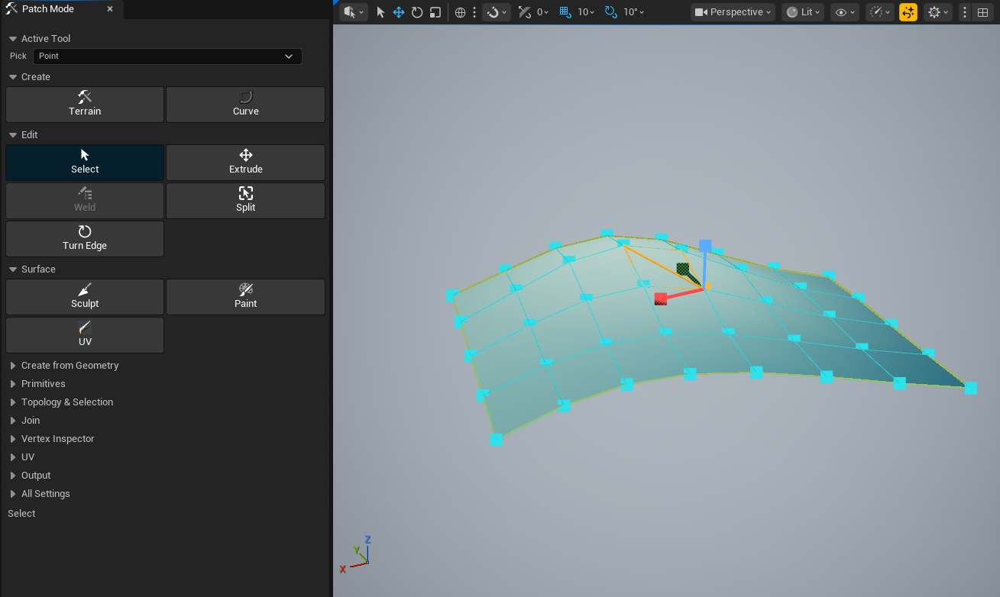
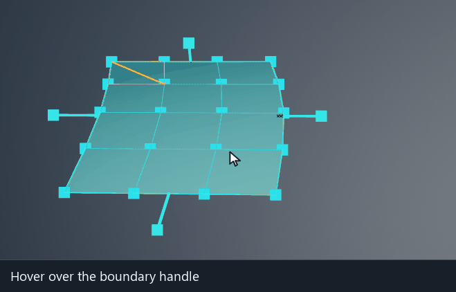
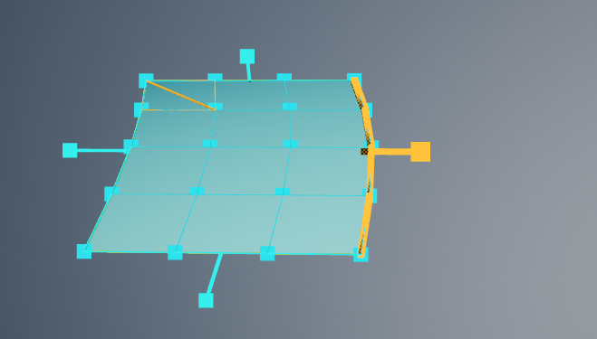
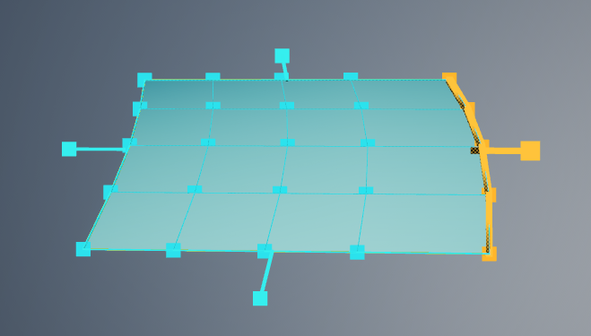
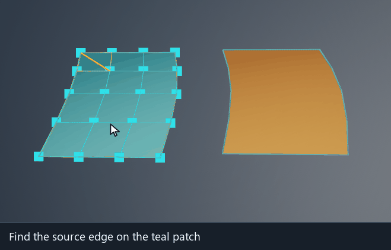
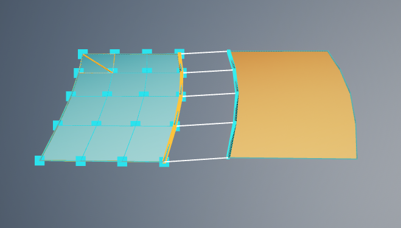
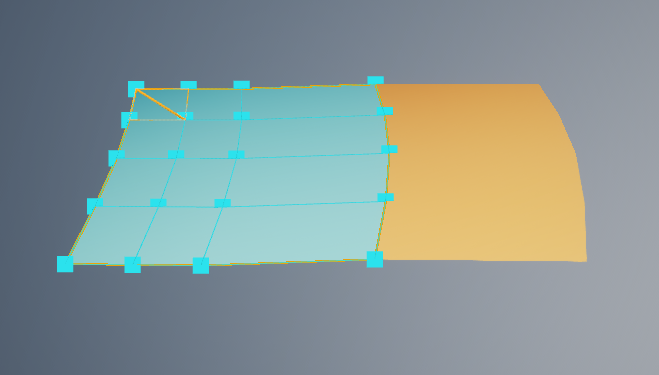
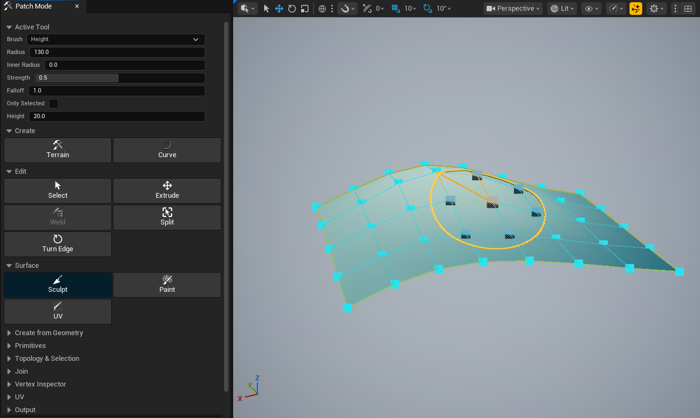
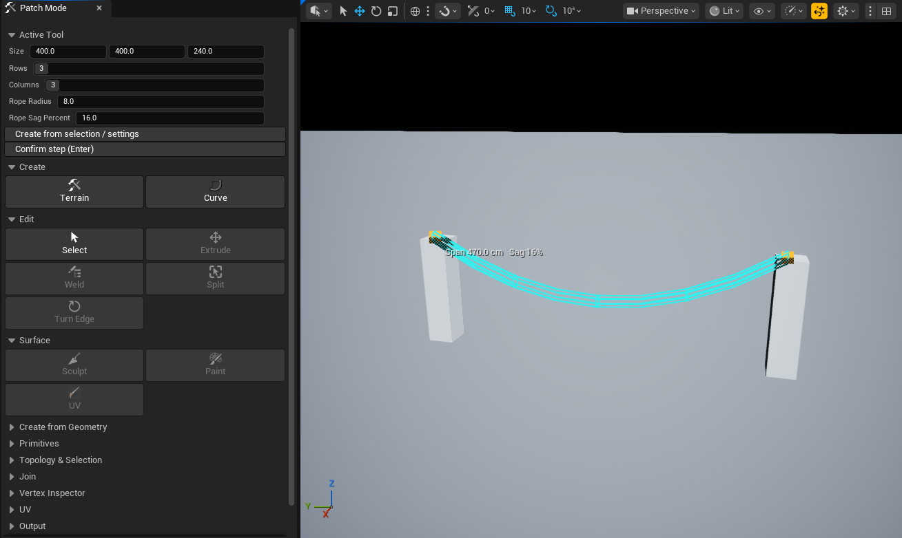

# Patch Mode

Patch Mode is an Unreal Editor plugin for shaping surfaces with a grid of control points. Use **Terrain** for roads and ground surfaces, or **Curve** for arches, pipes, and other rounded shapes. Each patch stays editable in the level. **Bake Static Mesh** creates a standard Unreal static mesh for use in the game.

The prebuilt **0.2.2** release targets **Unreal Engine 5.8.4 on Windows x64**. The **0.3.0-dev** source build adds edge alpha feathering, typed extrusion lengths, and seam diagnostics.



<a id="установка"></a>

## Installation

### Install from the 0.2.2 release ZIPs

Close Unreal Editor. Both destinations below are relative to the folder containing your `.uproject` file.

| Download | Where to extract it | File to look for |
| --- | --- | --- |
| [Patch Mode 0.2.2 for UE 5.8.4 / Win64](https://github.com/hutler/PatchMode/releases/download/v0.2.2/PatchMode-0.2.2-UE5.8.4-Win64.zip) | `Plugins/` | `Plugins/PatchMode/PatchMode.uplugin` |
| [PatchCollisionTest level, meshes, and Python script](https://github.com/hutler/PatchMode/releases/download/v0.2.2/PatchCollisionTest-0.2.2-UE5.8.4.zip) | Project root, beside the `.uproject` file | `Content/Tests/PatchCollisionTest.umap` |

Open the project and enable **Patch Mode** under **Edit → Plugins**. To run the sample collision check, also enable **Python Editor Script Plugin**. Restart the editor if prompted. Select **Patch Mode** from the Level Editor mode selector to start editing, or follow the [collision check](#collision-check) to test the baked mesh.

### Build from source

1. Clone or copy this repository into `Plugins/PatchMode` in your C++ project. The plugin descriptor should be at `Plugins/PatchMode/PatchMode.uplugin`.
2. Build the project's Editor target using **Development Editor / Win64**, then open the project.
3. Enable **Patch Mode** under **Edit → Plugins** if needed, then select **Patch Mode** from the Level Editor mode selector.

## Viewport editing

| Task | Controls |
| --- | --- |
| Create a patch | Choose **Terrain** or **Curve**. Click to place its center, move the pointer to size the preview, then click again to confirm. |
| Move a control point | With **Select** active, click a point and drag a colored axis. The viewport shows the offset as you drag. |
| [Extend a terrain edge](#extrude-a-terrain-edge) | Choose **Extrude** and drag a boundary handle outward. For an exact distance, use **Active Tool → Extrude by length**. |
| Place a rope | Choose **Primitives → Rope**, set **Rope Radius** and **Rope Sag Percent** under **Active Tool**, then click the two anchor positions in the viewport. |
| [Join two patches](#connect-two-patch-edges) | Choose **Join → Connect Edges**. Click the source edge, then the destination edge. Press **R** to reverse the pairing, **Enter** to apply, or **Esc** to cancel. |
| Sculpt or paint | **Sculpt** changes the surface shape. **Paint** edits vertex color and alpha. The brush outline and highlighted points show which part of the surface a stroke will affect. |

In an orthographic view, **Terrain**, **Curve**, and **Draw Terrain** create patches in the plane of the screen, facing the camera. A positive **Height** in **Sculpt** raises points along the patch's local Z axis. When control points project to the same screen position, picking favors the point nearest the camera.

You can also split and refine the grid, lock points, edit three UV channels, and build shells. Press **Ctrl+Z** to undo a completed gesture.

### Extrude a terrain edge

Select the Terrain patch and choose **Extrude**. Hover over the right boundary until its handle turns gold, then drag outward and release. Here, a 150 cm drag adds a fifth column of control points. The original edge stays in place as an interior grid line.

In **0.3.0-dev**, hold the mouse button on the handle and type a signed distance in centimeters, such as `37.5`. The typed length overrides grid snapping. Press **Enter** or release the mouse to commit, or press **Esc** to cancel. **Backspace** clears digits. Clearing the field resumes mouse dragging.



<details>
<summary>Compare the terrain before and after the drag</summary>

| Before dragging | After releasing the handle |
| --- | --- |
|  |  |

</details>

### Connect two patch edges

Choose **Join → Connect Edges**. Click the right edge of the teal source patch, then the facing edge of the orange destination patch. Both patches must have the same surface type, and the two edges must have the same number of control points. The white lines show which points will meet. If the lines cross, press **R** to reverse the pairing.

Press **Enter** to move the source edge onto the destination edge. The orange patch stays in place, and each patch remains a separate actor.

In **0.3.0-dev**, hover over a candidate edge to see its point count and whether it can connect. The viewport reports mismatched counts, the required surface type, or a locked source point that would have to move. A compatible pair shows the number of matched points before you confirm.



<details>
<summary>Compare the pairing preview with the finished seam</summary>

| Before pressing Enter | After pressing Enter |
| --- | --- |
|  |  |

</details>

### Sculpt a terrain patch

Choose **Sculpt** and move the pointer over the surface. The yellow ring shows the brush footprint. In this example, the **Height** brush has a radius of 130 cm and a strength of 0.5.



### Feather vertex alpha from an edge (0.3.0-dev)

Select a Terrain or Curve patch, choose **Paint**, then set **Edge** and **Feather Width** in **Active Tool**. Click **Feather Edge Alpha** to fade the chosen boundary to zero. Width is measured in world centimeters along the control grid. Lower alpha values you already painted are preserved. **Only Selected** limits the effect to selected points, and locked points keep their values.

With a vertex-alpha blend material, the band can soften a transition such as dirt along a road. A patch without an assigned material shows the mask in grayscale. The command switches the brush to **Paint Alpha** for touch-ups. **Ctrl+Z** restores the previous mask.

### Preview a rope

Click the first anchor, then move the pointer to the second. The viewport shows the span and sag before you confirm. Here the anchors are 470 cm apart, with **Rope Radius** set to 8 cm and **Rope Sag Percent** set to 16%.



<a id="проверка-коллизии-на-уровне-patchcollisiontest"></a>

## Collision check

`PatchCollisionTest` contains editable `Terrain` and `Curve` actors and a vertical baked mesh named `Curve_Baked`. The sample includes the level, all three scene meshes, and the check script. [Browse the sample files](Examples/PatchCollisionTest/Content)

1. Install the two release archives as described under [Installation](#installation). If you built from source, close the editor and copy `Tests`, `PatchMeshes`, and `Python` from `Examples/PatchCollisionTest/Content` into your project's `Content` folder. Enable **Python Editor Script Plugin** before running the check.
2. In the **Content Browser**, open **Content → Tests → PatchCollisionTest**.
3. In the **Cmd** field of the **Output Log**, run `py check_patch_collision.py`.

The script traces the **Visibility** channel through the surface, ignoring the editable `Curve` actor. It expects to hit the static mesh component on `Curve_Baked` at **80 cm**, within a tolerance of **0.5 cm**. A second ray points away from the surface and should travel unobstructed. A successful run prints this line in the Output Log.

```text
PatchCollisionTest PASS | Curve_Baked.StaticMeshComponent0 | 80.00 cm | impact (-420.0, 211.0, -17.0) | control ray clear
```

## Editor automation tests

In a test project, open **Session Frontend → Automation** and run the `PatchMode` group. The tests create temporary levels. To check a specific projection, activate that view in the Level Editor first. The viewport tests exercise point selection and dragging, boundary extrusion, and switching a terrain cell's diagonal.

## License

Patch Mode is released under the [MIT License](LICENSE).
